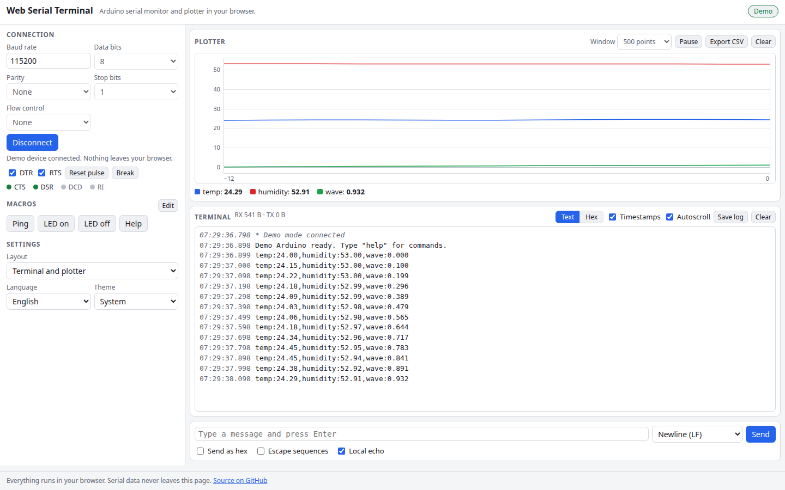

# Web Serial Terminal

A serial monitor and plotter for Arduino, ESP32 and any other UART device, running entirely in your browser through the Web Serial API. Pick a port, set the baud rate and framing, then read and send text or raw hex, watch numeric values on a live plot and drive the DTR/RTS lines. No browser support for Web Serial? A built-in demo device lets you try everything.

**Try it: [hermes98761234.github.io/web-serial-terminal](https://hermes98761234.github.io/web-serial-terminal/)**

[](https://github.com/hermes98761234/web-serial-terminal/actions/workflows/deploy.yml)



## Features

- **Full port settings.** Any baud rate from 50 to 12 000 000 (with the usual presets), 7 or 8 data bits, parity, 1 or 2 stop bits and RTS/CTS flow control.
- **Text and hex views** with optional millisecond timestamps, autoscroll, a 20 000 line buffer and per-line direction (RX, TX, status).
- **Send** text or hex bytes with a line ending of your choice (none, LF, CR, CRLF), optional backslash escapes (`\n`, `\r`, `\t`, `\xNN`), local echo and an up/down arrow history.
- **Macros** for the commands you send all the time, saved in the browser.
- **Live plotter, compatible with the Arduino Serial Plotter.** Lines such as `12,34`, `1 2 3` or `temp:21.5,hum:40` become labeled series with auto-scaling, a selectable window, hover readout, pause and CSV export.
- **DTR and RTS control**, a one-click DTR reset pulse, a break signal and live CTS/DSR/DCD/RI indicators.
- **Log saving** as a timestamped text file (text or hex form).
- **Demo mode** with a fake Arduino that streams sensor values and answers `help`, `ping`, `led on|off`, `version` and `echo`. It works in any browser.
- **English and Ukrainian, light, dark or system theme.** Settings are remembered in the browser. Nothing is sent anywhere.

## How it works

Web Serial opens the port you pick in the browser's chooser and gives a readable and a writable byte stream. The incoming bytes are split into lines (on LF, with CR stripped, or after 1024 bytes without one) and kept in a ring buffer. Each completed line is also parsed the way the Arduino Serial Plotter does it: the whole line must be numbers separated by commas, spaces or tabs, optionally as `label:value` pairs, otherwise it is only shown in the terminal. Updates are batched to one render per animation frame, so fast streams stay smooth.

Web Serial works in Chrome, Edge and Opera on desktop, on HTTPS or localhost. Firefox and Safari do not implement it, which is why the demo mode exists. Opening a port toggles DTR, which resets most Arduino boards. That is the operating system's and the browser's behavior, not something the page can avoid.

## Quick start

You need [Node.js](https://nodejs.org/) 22.

```bash
git clone https://github.com/hermes98761234/web-serial-terminal.git
cd web-serial-terminal
npm install
npm run dev       # http://localhost:5173
npm test          # byte, line, plot, demo and i18n tests
npm run build     # static site in dist/
```

## License

MIT
